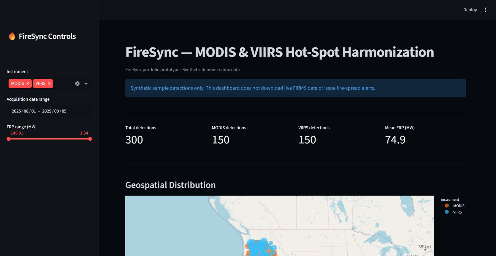

# Local validation record

Reviewed on October 25, 2026. Base public commit: `6379f4526722b73459c9afa3029e038dc56297b7`.

These results apply to the revised files accompanying this record, tested locally before repository publication. They do not establish the behavior of the original base commit or any later revisions.

## Executed checks

- `python -m pytest tests -q`: **19 passed in 4.38s** after the code fixes.
- Streamlit ran on `127.0.0.1:8501`; Chrome displayed 300 synthetic detections (150 MODIS, 150 VIIRS), the map and chart sections, and an explicit synthetic-data notice.
- The Streamlit AppTest covered initial rendering and an empty instrument selection; both completed without app exceptions.
- `git diff --check` passed. New source and test files are included in this working copy.

## Environment

Python 3.12.0; Streamlit 1.65.0; Plotly 5.24.1; pandas 2.2.3; NumPy 2.1.1; GeoPandas 1.2.0; pyproj 3.8.0; Folium 0.20.0; pytest 8.2.2.

## Fixes covered

Missing sample-data import, empty dashboard selection, WGS84 ground-distance thresholds, one-to-one matching, retention of unmatched detections, fixed-weight FRP output, CSV timestamp parsing and invalid coordinate rejection, output directory creation, empty-map rendering, supported API request range, service-error response rejection, and suppression of private-key-bearing request exception text.

The map tile provider was changed to OpenStreetMap after the installed Folium version warned that the previous CartoDB tiles require a key. Basemap tiles still require network access. External tile-service availability is not guaranteed by this test.

## Not established

- A successful live FIRMS request: all request tests used synthetic fixtures and mocked responses.
- End-to-end data freshness, operational latency, independent scientific accuracy, optimal matching, performance at regional scale, or validated FRP calibration.
- A public deployment, competition eligibility, participation, submission, acceptance, award, or compliance with an identified challenge.
- Fire-spread forecasts, operational dispatch advice, or automated spread alerts.

README and presentation now state these limits. The owner explicitly selected MIT and supplied Alireza Sani as the copyright holder. The revised local copy includes LICENSE with a 2026 notice; this does not assert any competition year or retroactively change the reviewed public snapshot.

The validation itself involved no competition form save or submission. Repository publication, if performed afterward, does not constitute a competition submission.
